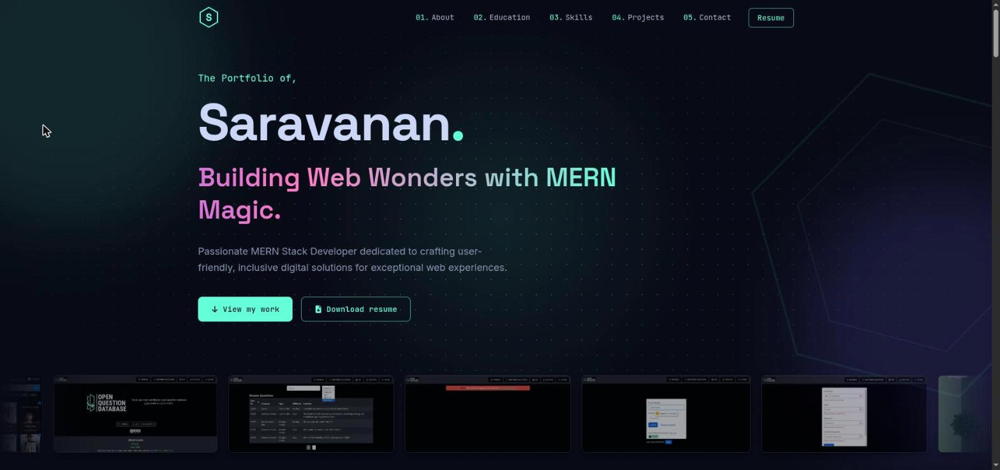

# 👨‍💻 Saravanan — Developer Portfolio

My personal portfolio website. It showcases my projects, skills, education and certifications, and has a working contact form.

**▶ Live site: [saravanan-22.github.io/react-portfolio](https://saravanan-22.github.io/react-portfolio/)**



## Sections

- 🏠 Animated intro and hero with a live screenshot marquee
- 🙋 About me, with resume download
- 🎓 Education timeline that draws itself as you scroll
- 🛠️ Skills and certifications (click a certificate to enlarge it)
- 💼 Featured projects with swipeable screenshot carousels, plus JavaScript mini projects
- ✉️ Contact form powered by EmailJS

## Tech stack

React 19 · TypeScript · Vite · Tailwind CSS v4 · Motion (animations) · EmailJS · React Icons · Vitest + Testing Library · oxlint · Prettier

Animations respect the operating system's **reduced motion** setting.

## Run locally

Requires Node.js 20.19+ or 22.12+.

```bash
git clone https://github.com/saravanan-22/react-portfolio.git
cd react-portfolio
npm install
npm run dev
```

| Script            | What it does                                  |
| ----------------- | --------------------------------------------- |
| `npm run dev`     | Start the dev server with hot reload          |
| `npm run build`   | Type-check and build for production (`dist/`) |
| `npm run preview` | Serve the production build locally            |
| `npm test`        | Run the unit tests                            |
| `npm run lint`    | Lint with oxlint                              |
| `npm run format`  | Format with Prettier                          |

## Project structure

```
src/
  data/          # All content: projects, skills, education, links (edit these to update the site)
  components/
    layout/      # Navbar, footer, scroll progress bar
    sections/    # Intro, Hero, About, Education, Skills, Projects, Contact
    ui/          # Reusable pieces: carousel, lightbox, reveal-on-scroll, buttons
  hooks/         # useActiveSection (highlights the current nav item)
  assets/        # Optimised WebP images and the resume PDF
```

## Deployment

Pushing to `main` runs lint, format check, tests and the build, then deploys to GitHub Pages (see [.github/workflows/deploy-pages.yml](.github/workflows/deploy-pages.yml)). Pull requests run the same checks without deploying.

## License

[MIT](LICENSE) © Saravanan
